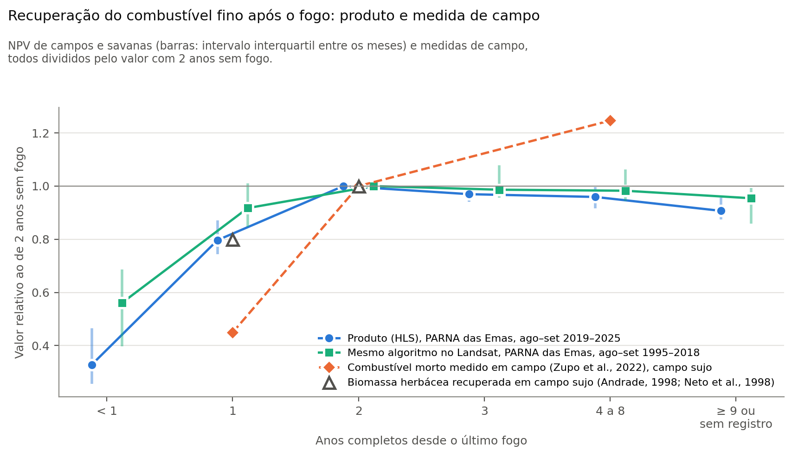
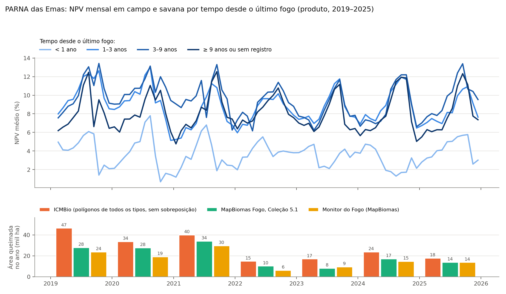
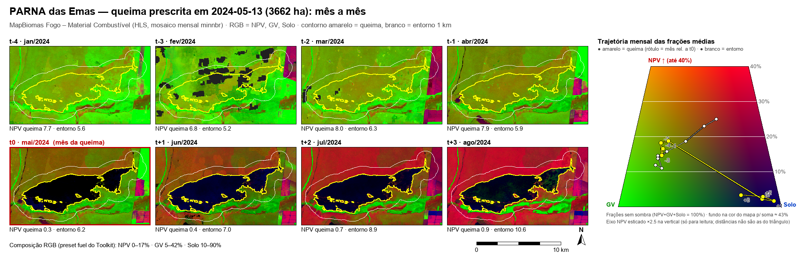
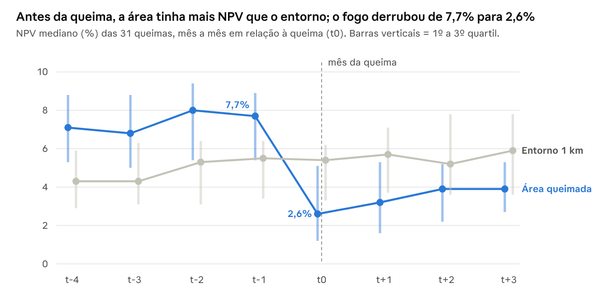
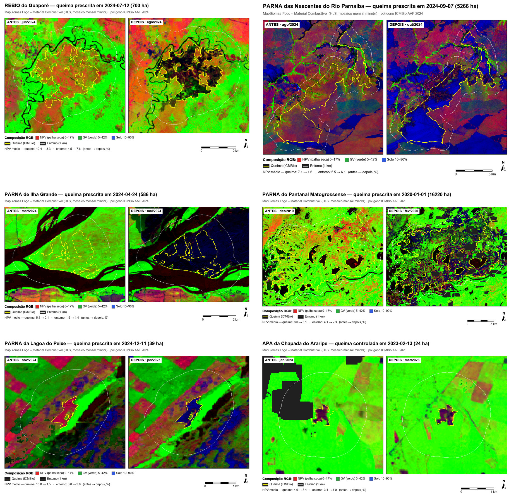
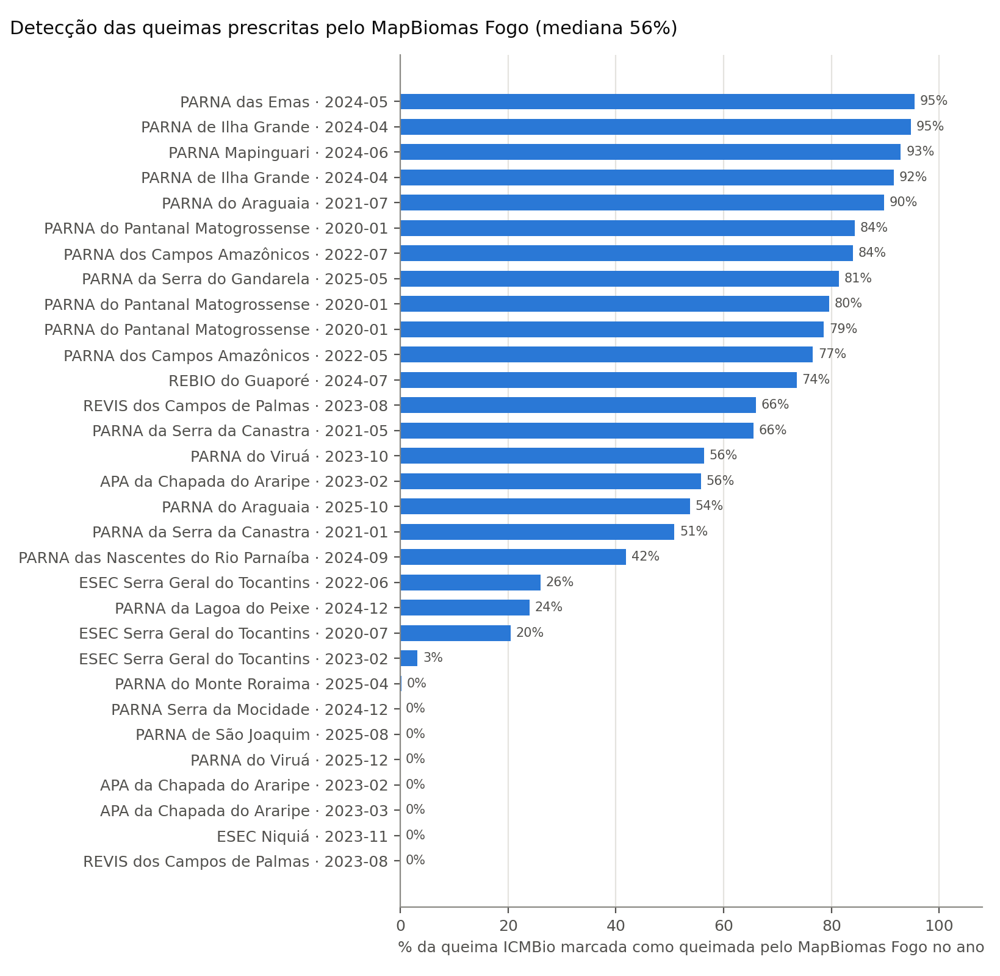
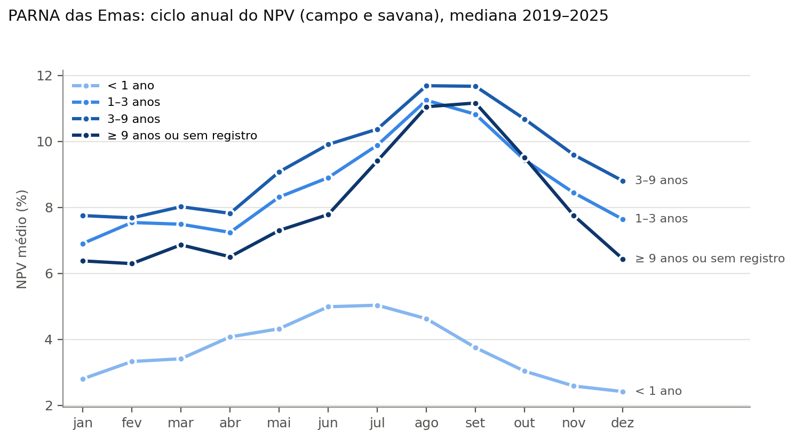
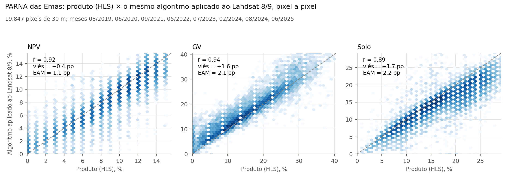
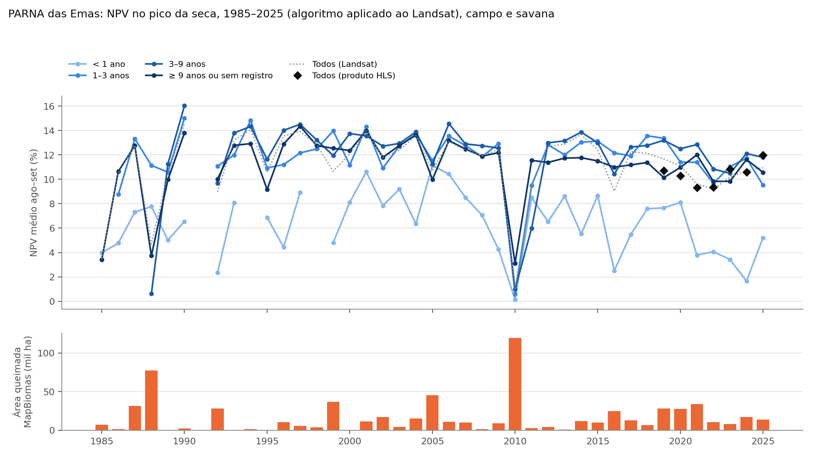

# Documento de Fundamentação Teórica do Algoritmo (ATBD)

**MapBiomas Fogo**

**Mapeamento de Material Combustível**

**Versão 3**

**Coordenadora geral**
Ane A. Alencar

**Equipe**
Vera Laísa da Silva Arruda
Wallace Vieira da Silva
Ana Carolina Pessoa

## Sumário

1. Introdução
2. Descrição metodológica
2.1. NASA Harmonized Landsat Sentinel-2 (HLS) e dados multiespectrais de entrada
2.2. Controle de qualidade e mascaramento de nuvens
2.3. Composição temporal: mosaico por qualidade de NBR mínimo (minNBR)
2.4. Análise de Mistura Espectral (SMA)
2.4.1. Conjunto de endmembers e métricas derivadas das frações
2.5. Derivação do Mapa de Material Combustível e especificações do produto
3. Avaliação do produto: resposta do NPV ao fogo
3.1. Dados e delineamento
3.2. Recuperação do combustível após o fogo
3.3. Queda do NPV com a queima
3.4. Síntese
4. Considerações de qualidade, limitações conhecidas e uso recomendado
5. Acesso aos dados e uso do Toolkit
5.1. Navegação e seleção de parâmetros no Toolkit
5.2. Exportação de mapas para o Google Drive
6. Próximos passos
7. Referências
Anexo A. Detecção das queimas prescritas e série do PARNA das Emas
Anexo B. Bibliotecas regionais de endmembers: resultados preliminares e métodos

## 1. Introdução

O produto de mapeamento de Material Combustível apoia a inteligência do fogo ao fornecer proxies espacialmente explícitos da condição do combustível de superfície, derivados de imagens multiespectrais de satélite. Em vez de estimar a carga de combustível em unidades físicas (por exemplo, t ha⁻¹), o algoritmo quantifica as abundâncias fracionárias subpixel de componentes de superfície funcionalmente ligados ao comportamento do fogo: Vegetação Verde (GV), Vegetação Não Fotossintética (NPV) e Solo exposto. Representações baseadas em frações resolvem de forma eficaz as variações ecológicas em paisagens heterogêneas, nas quais a mistura subpixel domina a resposta do sinal óptico (Adams et al., 1995; Roberts et al., 1993).

Em ambientes propensos ao fogo e sazonalmente secos, variações na abundância relativa de vegetação viva versus curada, combinadas com variações na exposição do solo, determinam a ignitabilidade da superfície, a continuidade do leito de combustível e a taxa potencial de propagação do fogo. A Vegetação Não Fotossintética (NPV), composta por gramíneas senescentes, serapilheira fina e material lenhoso morto, funciona como a principal camada de combustível fino responsável pela ignição e pela propagação do fogo em superfície. A Vegetação Verde (GV) reflete elementos do dossel com alto teor de umidade, que dificultam a ignição, enquanto o Solo exposto representa descontinuidades no leito de combustível e perturbações severas da superfície. A Análise de Mistura Espectral (SMA) foi validada como uma ferramenta robusta para separar esses sinais subpixel em ecossistemas tropicais, savânicos e de áreas úmidas (Small, 2004; Lu et al., 2003; Souza Jr. et al., 2005).

No contexto do manejo integrado do fogo (MIF) adotado nos biomas brasileiros, indicadores de combustível de superfície espacialmente explícitos e de alta frequência de revisita são essenciais para o planejamento operacional. Esses produtos apoiam o pré-posicionamento de recursos de combate, o monitoramento estratégico de aceiros, a avaliação de risco e o planejamento de queimas prescritas voltadas à mitigação de incêndios catastróficos no final da estação seca (Pivello, 2011; Cochrane, 2003). O produto Material Combustível do MapBiomas Fogo foi concebido como um conjunto de dados de sensoriamento remoto escalável, transparente e de alta frequência, que mapeia a condição relativa do combustível de superfície nos biomas brasileiros com resolução espacial de 30 metros.

A seção 2 descreve o algoritmo; a seção 3 avalia se o NPV responde ao fogo como o combustível fino medido em campo; as seções 4 e 5 tratam das limitações e do acesso aos dados; e a seção 6, das próximas versões.

## 2. Descrição metodológica

O fluxo geral de processamento (Figura 1) transforma observações brutas de refletância de superfície em mapas mensais contínuos (wall-to-wall) da condição do combustível. A metodologia integra séries temporais ópticas de alta revisita, um saneamento radiométrico rigoroso, a redução temporal baseada em qualidade por meio do Normalized Burn Ratio mínimo (minNBR) e a decomposição espectral linear.

*Figura 1 mantida da versão online. — ver a versão publicada do ATBD.*

**Figura 1.** Fluxo operacional de processamento do mapeamento de Material Combustível do MapBiomas Fogo. As imagens ópticas (NASA HLS v002 nos assets publicados; também Landsat C2 L2 e Sentinel-2 SR nos mosaicos em tempo real do Toolkit) passam por triagem de qualidade (Fmask 2.0 e mascaramento de refletância não positiva), são convertidas em NBR por pixel e reduzidas temporalmente ao composto de NBR mínimo. O mosaico resultante de 6 bandas é submetido a uma análise de mistura espectral linear sem restrição de soma (GV, NPV, solo, nuvem), com truncamento das frações negativas, e as frações, em porcentagem, são exportadas como um asset de 3 bandas do tipo Byte (RGB = NPV, GV, solo).

### 2.1. NASA Harmonized Landsat Sentinel-2 (HLS) e dados multiespectrais de entrada

O algoritmo não depende de um sensor específico e pode ser aplicado a qualquer constelação óptica com as seis bandas descritas abaixo. Os assets publicados, de 2019 em diante, usam o NASA Harmonized Landsat Sentinel-2 (HLS v002), integrando os produtos HLSS30 (Sentinel-2A/2B MSI) e HLSL30 (Landsat 8/9 OLI), por ser a fonte com mais observações por período a 30 metros. No Toolkit, o mesmo algoritmo é aplicado sob demanda a outras coleções, entre elas Sentinel-2 SR (COPERNICUS/S2_SR_HARMONIZED) e Landsat Collection 2 Level-2 (Landsat 5, 7, 8 e 9), o que estende a análise a períodos anteriores ao HLS (seção 5.1).

Todas as séries temporais ópticas são padronizadas para uma grade espacial comum de 30 metros e um espaço espectral unificado de 6 bandas, composto pelas bandas Azul, Verde, Vermelho, Infravermelho Próximo (NIR), Infravermelho de Ondas Curtas 1 (SWIR1) e Infravermelho de Ondas Curtas 2 (SWIR2). Para as observações Sentinel-2 e HLSS30, a banda NIR estreita (B8A) é selecionada para se alinhar à banda NIR do Landsat OLI (B5). A combinação de dados Landsat e Sentinel-2 no âmbito do HLS aumenta a frequência efetiva de revisita para 2–3 dias, fornecendo a densidade temporal necessária para acompanhar flutuações rápidas na umidade da vegetação e na disponibilidade de combustível fino.

### 2.2. Controle de qualidade e mascaramento de nuvens

Séries temporais ópticas em ambientes tropicais e de savana são suscetíveis à contaminação por nuvens, sombras de nuvens, sombras de relevo e artefatos de processamento radiométrico. Na composição temporal baseada em qualidade, anomalias de refletância negativa não mascaradas atuam como fontes severas de ruído, levando o algoritmo a selecionar pixels corrompidos por artefatos em vez de observações válidas da superfície.

Cenas HLS sabidamente problemáticas são retiradas por uma lista de bloqueio mantida pela equipe. Para eliminar os demais artefatos, uma triagem de qualidade em duas etapas é aplicada a cada cena antes da composição:

- **Mascaramento atmosférico e de nuvens:** para os produtos HLS (HLSS30 e HLSL30), a banda de qualidade Fmask 2.0 é avaliada para mascarar pixels sinalizados como nuvem, sombra de nuvem, nuvem/sombra adjacente ou neve/gelo. Para os produtos Landsat avulsos, são avaliadas as bandas de avaliação de qualidade do pixel (QA_PIXEL) e de saturação (QA_RADSAT), descartando-se 3 km na borda das cenas. Para os produtos Sentinel-2 avulsos, aplica-se um limiar de céu limpo com base na camada de qualidade Cloud Score+ (CS+ ≥ 0,40).
- **Refletância não positiva:** para remover valores negativos de refletância de superfície induzidos por sobrecorreção em alvos escuros, sombras profundas ou bordas do sensor, um filtro estrito de pixel válido em múltiplas bandas exige que a refletância de superfície seja estritamente positiva em todas as seis bandas ópticas. Observações que não atendem a essa condição são excluídas do conjunto de candidatas.

### 2.3. Composição temporal: mosaico por qualidade de NBR mínimo (minNBR)

Para cada período de mapeamento mensal, a pilha de observações triadas é reduzida a uma única imagem composta representativa por meio de um mosaico por qualidade (Quality Mosaic) orientado pelo Normalized Burn Ratio (NBR), calculado a partir das bandas Infravermelho Próximo (NIR) e Infravermelho de Ondas Curtas 2 (SWIR2).

Como a ocorrência de fogo provoca uma queda acentuada do NBR, em razão da perda de dossel, da redução de umidade e da exposição de carvão, o algoritmo seleciona, para cada pixel, a observação correspondente ao menor valor de NBR dentro da janela temporal. No Google Earth Engine, essa composição é executada por meio de qualityMosaic sobre a banda (1 − NBR) × 1000, cujo máximo corresponde ao NBR mínimo, selecionando a data de aquisição associada ao pico de perturbação ou à cura máxima da vegetação. O composto herda o vetor completo de refletância óptica de 6 bandas dessa única data, preservando a consistência espectral interna e evitando artefatos de mistura entre datas.

Essa estratégia preserva cicatrizes de fogo de curta duração e eventos de pico de consumo de combustível, que seriam suavizados por redutores convencionais de mediana ou média.

A regra tem, portanto, dois efeitos. Em pixels sem fogo no mês, seleciona a data de maior cura, isto é, de maior disponibilidade de combustível fino, que é o estado relevante para o planejamento. Em pixels queimados, seleciona a cicatriz, e o mapa daquele mês mostra o combustível já consumido (seção 3.3). Um composto pela mediana (monthly_median) também é gerado; este documento trata do minNBR.

### 2.4. Análise de Mistura Espectral (SMA)

Para quantificar a composição subpixel da superfície relevante para a caracterização do combustível, a Análise de Mistura Espectral Linear (SMA) é aplicada aos mosaicos de refletância de superfície minNBR de 6 bandas. A SMA modela o espectro de cada pixel como uma combinação linear de componentes espectralmente puros (endmembers), produzindo estimativas de abundância fracionária que são fisicamente significativas e mais diretamente relacionadas à estrutura do combustível do que índices espectrais de banda única. Essa abordagem é particularmente adequada a imagens de resolução média em ambientes tropicais e de savana, onde pixels individuais comumente contêm misturas de vegetação verde, vegetação senescente ou seca e solo exposto (Adams et al., 1995; Souza Jr. et al., 2003).

O uso da SMA tem sido amplamente adotado nos biomas brasileiros para caracterizar a condição do dossel, gradientes de perturbação e a composição da superfície, formando a base quantitativa de análises de degradação e orientadas ao fogo (Souza Jr. et al., 2003; Souza Jr. et al., 2005). Ao decompor cada pixel em componentes fotossintéticos e não fotossintéticos discretos, a SMA fornece uma representação robusta de parâmetros relacionados ao combustível, com destaque para a Vegetação Não Fotossintética (NPV), que se correlaciona diretamente com a biomassa superficial seca e combustível.

Antes da decomposição (unmixing), os valores de refletância de superfície (em escala 0–1, em unidades de refletância de superfície) são multiplicados por 10.000 para se alinharem à escala da biblioteca espectral de endmembers. A decomposição é resolvida por mínimos quadrados sem restrição de soma unitária, e os valores negativos de fração são então truncados para zero por meio de uma função de limiar inferior (max(0)). As frações são então convertidas em unidades percentuais de cobertura (0–100%) e em inteiros de 16 bits (int16), para armazenamento operacional e eficiência computacional.

Sem a restrição de soma, as frações de um pixel não somam 100%; o restante é sobretudo sinal escuro (sombra, carvão e água), não modelado pelos endmembers. Nas queimas analisadas na seção 3, NPV, GV e Solo somaram cerca de 43% antes do fogo e 14% nas cicatrizes. A formulação foi confirmada reproduzindo o produto com o mesmo algoritmo no Landsat: a versão sem restrição reproduz o NPV do produto (r = 0,92), e a versão restrita fica cerca de 22 pontos percentuais acima (Anexo A.3.2). Ponto percentual (pp) é a diferença entre duas porcentagens: um NPV que passa de 5% para 7% aumentou 2 pontos percentuais, e não 2%.

#### 2.4.1. Conjunto de endmembers e métricas derivadas das frações

Foi aplicada uma biblioteca de quatro endmembers, representando os componentes ópticos dominantes observados nos mosaicos, seguindo o arcabouço de mistura espectral estabelecido para ecossistemas tropicais por Souza Jr. et al. (2003, 2005), com os valores da implementação em Google Earth Engine de Souza Jr. et al. (2024):

- **Vegetação Verde (GV):** elementos do dossel fotossinteticamente ativos, com alta refletância no NIR e forte absorção no Vermelho.
- **Vegetação Não Fotossintética (NPV):** vegetação senescente, serapilheira, gramíneas curadas e biomassa morta em pé, com alta refletância no SWIR1/SWIR2 em relação ao NIR.
- **Solo:** solos minerais expostos, afloramentos rochosos e substratos de solo nu.
- **Nuvem:** incluída como endmember de referência brilhante, para absorver névoa atmosférica residual ou contaminação por cirrus.

Os espectros puros dos endmembers são definidos nas seis bandas ópticas padronizadas, na ordem estrita Azul, Verde, Vermelho, NIR, SWIR1, SWIR2:

- **GV:** [119.0,475.0,169.0,6250.0,2399.0,675.0]
- **NPV:** [1514.0,1597.0,1421.0,3053.0,7707.0,1975.0]
- **Solo:** [1799.0,2479.0,3158.0,5437.0,7707.0,6646.0]
- **Nuvem:** [4031.0,8714.0,7900.0,8989.0,7002.0,6607.0]

Essa configuração de endmembers é consistente com formulações de SMA amplamente aplicadas nos biomas brasileiros, nas quais as frações GV/NPV/Solo explicam a maior parte da variabilidade espectral da superfície terrestre e a inclusão de um endmember Nuvem melhora a robustez a efeitos atmosféricos residuais (Souza Jr. et al., 2003; Souza Jr. et al., 2005). O procedimento de SMA gera, para cada pixel, camadas de fração de GV, NPV, Solo e Nuvem, que constituem a base quantitativa para a representação subsequente do material combustível. Diferentemente do método original, não há endmember de sombra. A origem e as limitações desse conjunto são discutidas na seção 6.

### 2.5. Derivação do Mapa de Material Combustível e especificações do produto

Os Mapas de Material Combustível são derivados diretamente das bandas de fração primárias estimadas pela decomposição espectral linear (npv, gv, soil) e integrados aos assets compostos finais. Essas camadas de fração subpixel são interpretadas como proxies de superfície fisicamente significativos, diretamente ligados à condição do combustível, ao estresse hídrico/térmico e à dinâmica de inflamabilidade:

- **Vegetação Não Fotossintética (NPV):** quantifica a abundância relativa de material vegetal seco, senescente ou dormente, serapilheira e resíduos de culturas agrícolas. Valores altos de NPV indicam estresse hídrico ou térmico severo, marcando áreas de alta inflamabilidade superficial e acúmulo de combustível fino.
- **Vegetação Verde (GV):** quantifica elementos do dossel fotossinteticamente ativos, com alto teor de umidade e estresse térmico mínimo. Valores altos de GV representam vegetação viva e hidratada, que atua como barreira natural, reduzindo a inflamabilidade superficial e dificultando a propagação do fogo.
- **Solo:** quantifica solo mineral exposto, afloramentos rochosos e cicatrizes de queimadas recentes onde a cobertura vegetal foi consumida. Valores altos de Solo destacam descontinuidades físicas no leito de combustível ou condições do terreno pós-fogo.

Esse arcabouço baseado em frações está alinhado a metodologias consolidadas para ambientes tropicais e de savana (Adams et al., 1995; Souza Jr. et al., 2003; Souza Jr. et al., 2005). Para inspeção visual e inteligência operacional, um composto RGB em falsa cor é gerado com intervalos de exibição fixos por canal: R = NPV [0–17], G = GV [5–42] e B = Solo [10–90]. Os intervalos foram definidos por inspeção visual em três escalas (Brasil, Distrito Federal e Pantanal) e são necessários porque as frações têm faixas muito diferentes: o NPV raramente passa de 15%, enquanto o Solo passa de 80% em superfícies expostas. Por serem fixos, permitem comparar as cores entre meses e regiões.

Nesse esquema, tons de vermelho/magenta destacam leitos de combustível secos e altamente inflamáveis; tons de verde indicam vegetação úmida e de baixa inflamabilidade; e tons de azul/ciano indicam solo exposto, superfícies rochosas ou cicatrizes de fogo recentes onde o combustível foi consumido. A mistura de cores pode ser interpretada por meio de um sistema de cores ternário, permitindo uma avaliação espacial rápida das condições do combustível de superfície e da continuidade da paisagem. Composições equivalentes já foram usadas no planejamento de queimas prescritas em unidades de conservação do Cerrado (Franke et al., 2018).

O composto serve para a interpretação visual; para classificar e quantificar, devem ser usadas as bandas de fração. Valores de NPV acima de 17% saturam no vermelho, e pixels escuros, com todas as frações baixas, podem ser água, sombra ou carvão. Nesses casos, uma soma baixa de NPV, GV e Solo indica sinal não explicado pelos endmembers; nos mosaicos em tempo real do Toolkit, também estão disponíveis a fração Nuvem e uma banda de sombra (|GV + NPV + Solo + Nuvem − 100|).

**Especificações e entrega do produto:**

Para otimizar o armazenamento, o processamento em nuvem e o desempenho de exportação em grandes extensões espaciais, as camadas de fração resultantes são formatadas como inteiros sem sinal de 8 bits (byte), gravados diretamente em porcentagem, sem reescala; valores acima de 100, possíveis sem restrição de soma, são mantidos até 255. Cada asset tem três bandas (npv, gv, soil); a fração Nuvem não é exportada. A área mapeada é delimitada pelos limites dos biomas do IBGE. Os produtos mensais finais são incorporados automaticamente a um asset do tipo ImageCollection no Earth Engine (projects/mapbiomas-mosaics/assets/FIRE/HLS/fuel_material/monthly_minnbr e monthly_median), com propriedades de metadados padronizadas (year, month, period, method, version, bands).

*Figura 2 mantida da versão online. — ver a versão publicada do ATBD.*

**Figura 2.** Mapa de material combustível de janeiro de 2026 no bioma Pantanal, gerado a partir do composto RGB (NPV, GV, Solo). O composto representa a variação espacial nas proporções relativas de GV (Vegetação Verde), NPV (Vegetação Não Fotossintética) e Solo (solo nu/exposto), indicando gradientes de vegetação viva, material combustível seco/senescente e terreno exposto.

## 3. Avaliação do produto: resposta do NPV ao fogo

Franke et al. (2018) mostraram, em três unidades de conservação do Cerrado, que a fração de vegetação seca obtida por mistura espectral acompanha a carga de combustível medida em campo (r² = 0,81), e mapas derivados dela passaram a ser usados pelo ICMBio no planejamento das queimas prescritas. A literatura de campo indica também como esse combustível varia com o tempo. Nos campos do Cerrado, o fogo consome mais de 97% da biomassa aérea (Kauffman et al., 1994), e o estrato herbáceo se recompõe cerca de 80% em um ano e totalmente em dois (Andrade, 1998; Neto et al., 1998, citados por Oliveras et al., 2013). Em queimas experimentais em campo sujo, o combustível morto passou de 0,31 kg/m² um ano após o fogo para 0,69 kg/m² com dois anos e 0,86 kg/m² com quatro, diferença não significativa em relação a dois anos (Zupo et al., 2022). Em outras savanas, o combustível atinge um patamar em dois a quatro anos (Cook, 2003; Govender et al., 2006, citados por Zupo et al., 2022).

Como o produto não estima carga (seção 4), a avaliação compara a forma da resposta do NPV ao fogo, e não valores absolutos. São duas perguntas: (1) depois do fogo, o NPV aumenta nos primeiros anos e se estabiliza, como o combustível fino medido em campo? (2) o NPV cai com a queima, como esperado pelo consumo do combustível?

### 3.1. Dados e delineamento

- Material Combustível: frações NPV, GV e Solo do mosaico mensal minNBR (seção 2), 2019–2025.
- Histórico de fogo: cicatrizes mensais do MapBiomas Fogo, Coleção 5.1 (1985–2025), das quais se obtém o tempo desde o último fogo de cada pixel, contando só fogos anteriores ao mês analisado. Cobertura: MapBiomas Coleção 11.
- Pergunta 1: série mensal do PARNA das Emas (cerca de 133 mil ha, 73% de campo e 20% de savana), onde o MapBiomas Fogo detecta bem as queimas, com o tempo desde o fogo em anos completos ("um ano" = 12 a 23 meses desde a última cicatriz).
- Pergunta 2: 31 queimas prescritas e controladas do ICMBio (2019–2025), as maiores de cada bioma e época do ano, com o NPV médio do polígono e de um entorno de 1 km de quatro meses antes (t0−4) a três meses depois (t0+3) da queima. A data (t0) vem do campo de observação do polígono ou, na falta dele, do mês de maior queda das frações.

Os métodos estão detalhados no Anexo A.1.

### 3.2. Recuperação do combustível após o fogo

No PARNA das Emas, o NPV de agosto e setembro nos campos e savanas aumentou nos dois primeiros anos após o fogo e depois se estabilizou (Figura 3). Em relação às áreas com dois anos sem fogo, o NPV mediano de 2019 a 2025 foi de 0,33 com menos de um ano, 0,80 com um ano e de 0,96 a 0,97 com três a oito anos. O mesmo algoritmo aplicado ao Landsat de 1995 a 2018 dá a mesma forma (0,56, 0,92 e 0,98), de modo que o padrão não se limita aos anos do produto. No mesmo parque, o incêndio de 2010, que atingiu cerca de 90% da área, permite seguir os mesmos lugares ao longo do tempo: o NPV de agosto e setembro caiu para cerca de 1% naquele ano, voltou a 9,5% em 2011 e chegou a 12,7% em 2012 (Anexo A.3.3).

A recomposição de cerca de 80% em um ano e completa em dois coincide com a descrita para o estrato herbáceo (Andrade, 1998; Neto et al., 1998). O produto não reproduz o aumento posterior de Zupo et al. (2022), de 1,25 com quatro anos, que os próprios autores não consideraram significativo. Nas áreas sem fogo há nove anos ou mais, o NPV cai para 0,91, o que é compatível com a perda de vigor das gramíneas (Oliveras et al., 2013), mas também pode refletir áreas mais úmidas, que queimam menos. A Figura 4 mostra a série mensal de Emas: as áreas queimadas no último ano ficam abaixo das demais durante todo o ciclo, contraste que permite localizar no mapa as áreas com combustível recomposto, como no planejamento das queimas em mosaico (Franke et al., 2018). A área queimada registrada pelo ICMBio fica de 1,2 a 2 vezes acima da detectada pelo MapBiomas Fogo e pelo Monitor do Fogo, coerente com a detecção incompleta das queimas prescritas pequenas (seção 4).

Figura 3. NPV de agosto e setembro nos campos e savanas do PARNA das Emas por anos completos desde o último fogo (MapBiomas Fogo, Coleção 5.1), no produto (2019–2025) e no mesmo algoritmo aplicado ao Landsat (1995–2018), comparado a medidas de campo em campo sujo: combustível morto em queimas experimentais (Zupo et al., 2022) e recuperação da biomassa herbácea após o fogo (Andrade, 1998; Neto et al., 1998). Cada série foi dividida pelo seu valor com dois anos sem fogo. Barras: intervalo interquartil entre os meses.

Figura 4. PARNA das Emas, 2019–2025. Acima: NPV médio mensal (%) nos campos e savanas, por tempo desde o último fogo (cicatrizes mensais do MapBiomas Fogo, Coleção 5.1). Abaixo: área queimada no ano, em mil hectares, segundo três fontes: polígonos do ICMBio de todos os tipos de fogo (área da união, sem contar sobreposições), MapBiomas Fogo Coleção 5.1 e Monitor do Fogo.

### 3.3. Queda do NPV com a queima

A queima prescrita realizada em 13/05/2024 no PARNA das Emas (3.662 ha) ilustra o padrão (Figura 5). De janeiro a abril, o NPV médio da área queimada variou entre 6,8% e 8,0%, contra 5,2% a 6,3% no entorno. No mês da queima, o NPV da área caiu para 0,3%, porque o mosaico minNBR do mês já mostra a cicatriz (seção 2.3). Três meses depois (agosto), permanecia em 0,9%, enquanto o entorno continuou acumulando material seco ao longo da estação seca, até 10,6%.

Figura 5. PARNA das Emas, queima prescrita de 13/05/2024. Cenas mensais do combustível (RGB = NPV, GV, Solo), com o contorno da queima (amarelo) e do entorno de 1 km (branco). À direita, trajetória mês a mês das frações médias no triângulo NPV–GV–Solo (eixo NPV ampliado 2,5 vezes apenas para facilitar a leitura).

Nas 31 queimas, o NPV mediano das áreas queimadas era de 7,7% no mês anterior ao fogo (t0−1) e caiu para 2,6% no mês da queima (Figura 6); houve queda em 24 das 31 queimas, com mediana de −4,5 pontos percentuais. A Figura 7 traz um exemplo por bioma. A comparação entre as áreas queimadas e o entorno antes da queima depende da vegetação do entorno e de uma amostra maior, e ficou para a próxima versão (seção 6).

Figura 6. NPV mediano (%) nas áreas queimadas e no entorno de 1 km, de quatro meses antes (t0−4) a três meses depois (t0+3) da queima. Pontos: mediana das 31 queimas; barras: intervalo do 1º ao 3º quartil.

Figura 7. Um exemplo por bioma, no mês anterior (ANTES) e no seguinte (DEPOIS) à queima (RGB = NPV, GV, Solo; contorno amarelo = queima; contorno branco = entorno de 1 km). Em preto, pixels sem dado por nuvem.

### 3.4. Síntese

O NPV do produto cai com a queima e se recompõe com a forma descrita em campo: cerca de 80% em um ano e estabilização em cerca de dois, tanto no período do produto quanto no Landsat desde 1995 e nos mesmos lugares após o incêndio de 2010 em Emas. Essa é a evidência, até aqui, de que o NPV acompanha o combustível fino. As limitações da avaliação estão na seção 4, e o detalhamento, no Anexo A.

## 4. Considerações de qualidade, limitações conhecidas e uso recomendado

Os Mapas de Material Combustível derivados da análise de mistura espectral quantificam a composição relativa subpixel da superfície, e não a biomassa física ou a carga de combustível diretamente (t⋅ha⁻¹). Como as frações representam a cobertura proporcional da superfície dentro de cada pixel de 30 metros, o produto foi concebido para análises comparativas no espaço e no tempo. Para a tomada de decisão operacional e a modelagem do comportamento do fogo, a interpretação deve ser complementada por medições de campo, métricas de estrutura da vegetação, contexto de cobertura da terra e bases históricas de cicatrizes de fogo (Adams et al., 1995; Small, 2004).

O uso da regra de composição por pixel de NBR mínimo (minNBR) faz com que os valores de fração capturem o estado da superfície no momento de pico de perturbação ou de cura máxima dentro da janela de mapeamento, e não uma condição temporal média. Embora esse comportamento esteja alinhado a arcabouços de mapeamento orientados a perturbações, os usuários devem considerar esse viés temporal ao interpretar tendências sazonais (Key & Benson, 2006).

Apesar da triagem de qualidade em múltiplas etapas, incluindo Fmask 2.0, Cloud Score+ e filtragem de refletância negativa, ruído atmosférico residual de cirrus finos, névoa ou bordas de nuvens pode ocasionalmente se propagar para as estimativas de fração. Nas áreas afetadas, a avaliação deve ser cruzada com a soma das frações (seção 2.5) e com os metadados de qualidade que acompanham o produto. Por fim, pequenas inconsistências radiométricas podem persistir entre os sensores Landsat e Sentinel-2, devido a diferenças nas funções de resposta espectral e na geometria de aquisição; embora o arcabouço HLS minimize essas discrepâncias, comparações entre sensores devem ser interpretadas com a devida cautela.

Além disso:

- **Frações relativas.** As frações não somam 100% (seção 2.4) e devem ser comparadas com a mesma fração em outras áreas ou meses. O NPV tem faixa estreita, em geral de 2% a 13%, e diferenças de 1 a 2 pontos percentuais estão perto do que o produto consegue separar.
- **Meses com fogo.** O mapa mostra a cicatriz, e não o combustível anterior (seção 2.3). Para o estado antes do fogo, use o mês anterior ou mascare as cicatrizes, lembrando que o MapBiomas Fogo detectou, em mediana, só 56% da área de cada queima prescrita, e nada em 8 das 31 (Anexo A.2).
- **Endmembers.** Um único conjunto, de origem amazônica, é usado em todos os biomas (seção 6); os valores absolutos e a separação entre NPV e Solo podem mudar nas próximas versões.
- **Validação.** A avaliação é indireta, pela forma da resposta ao fogo. A curva de recuperação foi obtida em uma única unidade de conservação, dominada por campos, e as 31 queimas foram escolhidas, não sorteadas. A resposta em formações florestais não foi avaliada, e a validação com medidas de carga de combustível ainda não foi feita.

## 5. Acesso aos dados e uso do Toolkit

O conjunto de dados de mapeamento de Material Combustível do MapBiomas Fogo está totalmente integrado ao Google Earth Engine (GEE), permitindo consultas espaciais em diferentes recortes territoriais (como biomas, estados, municípios e áreas protegidas), bem como seleções temporais personalizadas. A interface do Toolkit facilita a exploração dos dados por meio de um painel lateral dedicado, organizado em filtros territoriais, opções temporais e seleção de camadas do mapa, disponível em: https://code.earthengine.google.com/?scriptPath=users%2Fworkspaceipam%2Fcombustible-material-accumulation%3Atoolkit%2Fexplore_and_export.

### 5.1. Navegação e seleção de parâmetros no Toolkit

Como ilustrado no painel lateral do Toolkit, a exploração dos dados está organizada nos seguintes módulos operacionais:

- **Filtro territorial:** permite filtrar os limites geográficos por Biomas (por exemplo, Pantanal, Cerrado, Amazônia), Unidades da Federação (UF), Unidades de Conservação (UCs), Terras Indígenas (TIs), Assentamentos, Territórios Quilombolas ou Municípios agrupados por estado.
- **Filtro temporal:** define a periodicidade da análise (Anual, Semestral, Trimestral ou Mensal) e exibe os recortes temporais disponíveis (por exemplo, 2026_10, 2026_09), facilitando o monitoramento contínuo da dinâmica do combustível de superfície.
- **Seleção de camadas:** permite alternar entre os Mosaicos em Tempo Real e os Mosaicos Mensais de Combustível (HLS), usando os redutores minNBR ou mediana, além de bases de referência complementares de ocorrência de fogo. Os Mosaicos Mensais são os assets publicados e só existem na periodicidade mensal. Os Mosaicos em Tempo Real são calculados no momento da consulta, com o mesmo algoritmo, a partir das coleções do Earth Engine (HLS, Sentinel-2 SR, Landsat 5–9, MODIS e VIIRS), em qualquer periodicidade; a proximidade ao tempo real vem da atualização dessas coleções.

Ao ativar a visualização do mapa pelo botão MAP ON, o composto selecionado é exibido em RGB de falsa cor (NPV = Vermelho, GV = Verde, Solo = Azul), permitindo uma avaliação visual imediata da vegetação viva, do material combustível seco/senescente e do solo exposto na região de interesse.

### 5.2. Exportação de mapas para o Google Drive

O Toolkit oferece um fluxo direto para exportar imagens GeoTIFF para o Google Drive. Após selecionar a área de interesse (por exemplo, Parque Nacional da Chapada dos Veadeiros) e definir as dimensões da grade e os parâmetros de escala no painel de configuração de exportação, no canto superior direito, clicar em Exportar ON (ou ativar THUMBNAILS ON) gera a pré-visualização do mapa e o recorte em miniatura.

Ao clicar no ícone de download (seta para baixo), a tarefa de exportação é registrada na aba Tasks do ambiente do Google Earth Engine. A tarefa gerada (por exemplo, PARQUE_NACIONAL_DA_CHAPADA_DOS_VEADEIROS_2026_10_asset_minnbr_fuel) aparece em Unsubmitted Tasks; clicar em RUN inicia a exportação, salvando o asset GeoTIFF final na conta do Google Drive do usuário.

## 6. Próximos passos

O conjunto de endmembers atual foi extraído por Souza Jr. et al. (2005) de uma única cena Landsat ETM+ de 1999, em Sinop (MT), por PPI e seleção manual, e publicado numericamente por Souza Jr. et al. (2024). Ele representa, portanto, uma paisagem de transição amazônica, e seu NPV corresponde a pastagem senescente. Além disso, NPV e Solo têm o mesmo valor no SWIR1 (0,7707), justamente onde o NPV costuma se distinguir do solo; a origem desse valor será verificada com os autores. As primeiras bibliotecas regionais confirmaram que a separação entre NPV e Solo é o principal limite do produto em 6 bandas: o NPV regional ficou mais próximo do Solo regional que do NPV global (Anexo B.1).

O conjunto de endmembers será aprimorado em quatro frentes, com os métodos descritos no Anexo B.2:

- **Modelo de mistura:** sombra como endmember explícito, inversão restrita à soma unitária e RMSE do resíduo por pixel como camada de qualidade. Como a restrição altera bastante as frações (Anexo A.3.2), a série inteira terá de ser reprocessada.
- **Biblioteca de NPV:** candidatos extraídos na janela de máxima senescência de cada bioma, com extração espaço-espectral (SSEE) para o NPV de baixo contraste.
- **Bundles regionais:** por bioma e estação, agrupados pela forma espectral e usados na desmistura por MESMA.
- **Limite de detecção do NPV:** fração mínima detectável em cada bioma (Sabol et al., 1992), abaixo da qual os valores serão sinalizados.

Cada versão será comparada com a atual pela distribuição das frações, pelo RMSE, pela repetição da curva de recuperação após o fogo (seção 3.2) e pela validação com medidas de carga de combustível fino no Jalapão, onde NPV e Solo foram os melhores preditores da biomassa combustível (Franke et al., 2018; Santos et al., 2023). Os intervalos de exibição do composto RGB serão revistos a cada nova biblioteca.

A avaliação também será ampliada em duas análises. A primeira acompanhará o NPV nos anos seguintes a cada uma das cerca de 4 mil queimas prescritas e controladas do ICMBio de 2019–2025, cuja data é conhecida; assim, a recuperação passa a ser medida nos mesmos lugares e deixa de depender do tempo desde o último fogo do MapBiomas, que detecta só parte dessas queimas (Anexo A.2). A segunda comparará, nessa mesma amostra, as áreas escolhidas para queima com o entorno de mesma cobertura antes do fogo.

## 7. Referências

**Adams, J.B., Sabol, D.E., Kapos, V., Almeida Filho, R., Roberts, D.A., Smith, M.O., & Gillespie, A.R. (1995).** Classification of multispectral images based on fractions of endmembers: Application to land-cover change in the Brazilian Amazon. *Remote Sensing of Environment*, 52(2), 137–154. https://doi.org/10.1016/0034-4257(94)00098-8

**Adams, J.B., Smith, M.O., & Johnson, P.E. (1986).** Spectral mixture modeling: A new analysis of rock and soil types at the Viking Lander 1 site. *Journal of Geophysical Research*, 91(B8), 8098–8112.

**Andrade, S.M.A. (1998).** Dinâmica do combustível fino e produção primária do estrato rasteiro de áreas de campo sujo de cerrado submetidas a diferentes regimes de queima. Dissertação de mestrado, Universidade de Brasília.

**Bateson, A., & Curtiss, B. (1996).** A method for manual endmember selection and spectral unmixing. *Remote Sensing of Environment*, 55(3), 229–243.

**Chang, C.-I, Wu, C.-C., & Chen, H.-M. (2010).** Random pixel purity index. *IEEE Geoscience and Remote Sensing Letters*, 7(2), 324–328.

**Cochrane, M.A. (2003).** Fire science for rainforests. *Nature*, 421, 913–919. https://doi.org/10.1038/nature01437

**Cook, G.D. (2003).** Fuel dynamics, nutrients, and atmospheric chemistry. In: Andersen, A.N., Cook, G.D., & Williams, R.J. (Eds.), *Fire in Tropical Savannas: The Kapalga Experiment* (pp. 47–58). Springer-Verlag.

**Dennison, P.E., & Roberts, D.A. (2003).** Endmember selection for multiple endmember spectral mixture analysis using endmember average RMSE. *Remote Sensing of Environment*, 87(2–3), 123–135.

**Franke, J., Barradas, A.C.S., Borges, M.A., Menezes Costa, M., Dias, P.A., Hoffmann, A.A., Orozco Filho, J.C., Melchiori, A.E., & Siegert, F. (2018).** Fuel load mapping in the Brazilian Cerrado in support of integrated fire management. *Remote Sensing of Environment*, 217, 221–232. https://doi.org/10.1016/j.rse.2018.08.018

**Govender, N., Trollope, W.S.W., & Van Wilgen, B.W. (2006).** The effect of fire season, fire frequency, rainfall and management on fire intensity in savanna vegetation in South Africa. *Journal of Applied Ecology*, 43, 748–758.

**Kauffman, J.B., Cummings, D.L., & Ward, D.E. (1994).** Relationships of fire, biomass and nutrient dynamics along a vegetation gradient in the Brazilian cerrado. *Journal of Ecology*, 82(3), 519–531.

**Key, C.H., & Benson, N.C. (2006).** Landscape Assessment (LA). In: *FIREMON: Landscape Assessment System*. USDA Forest Service, Rocky Mountain Research Station, General Technical Report RMRS-GTR-164-CD.

**Lu, D., Moran, E., & Batistella, M. (2003).** Linear mixture model applied to Amazonian vegetation classification. *Remote Sensing of Environment*, 87(4), 456–469. https://doi.org/10.1016/j.rse.2002.06.001

**Neto, W.N., Andrade, S.M.A., & Miranda, H.S. (1998).** The dynamics of the herbaceous layer following prescribed burning: a four year study in the Brazilian savanna. In: Viegas, D.X. (Ed.), *Proceedings of the 14th Conference on Fire and Forest Meteorology*, v. 2, pp. 1785–1792. University of Coimbra.

**Oliveras, I., Meirelles, S.T., Hirakuri, V.L., Freitas, C.R., Miranda, H.S., & Pivello, V.R. (2013).** Effects of fire regimes on herbaceous biomass and nutrient dynamics in the Brazilian savanna. *International Journal of Wildland Fire*, 22, 368–380.

**Pivello, V.R. (2011).** The use of fire in the Cerrado and Amazonian rainforests of Brazil: past and present. *Fire Ecology*, 7(1), 24–39. https://doi.org/10.4996/fireecology.0701024

**Roberts, D.A., Gardner, M., Church, R., Ustin, S., Scheer, G., & Green, R.O. (1998).** Mapping chaparral in the Santa Monica Mountains using multiple endmember spectral mixture models. *Remote Sensing of Environment*, 65, 267–279.

**Roberts, D.A., Smith, M.O., & Adams, J.B. (1993).** Green vegetation, non-photosynthetic vegetation, and soils in AVIRIS data. *Remote Sensing of Environment*, 44(2–3), 255–269. https://doi.org/10.1016/0034-4257(93)90020-X

**Rogge, D.M., Rivard, B., Zhang, J., Sanchez, A., Harris, J., & Feng, J. (2007).** Integration of spatial–spectral information for the improved extraction of endmembers. *Remote Sensing of Environment*, 110.

**Sabol, D.E., Adams, J.B., & Smith, M.O. (1992).** Quantitative subpixel spectral detection of targets in multispectral images. *Journal of Geophysical Research*, 97(E2), 2659–2672.

**Santos, M.M., Batista, A.C., Rezende, E.H., Da Silva, A.D.P., Cachoeira, J.N., Dos Santos, G.R., Biondi, D., & Giongo, M. (2023).** Estimating the surface fuel load of the plant physiognomy of the Cerrado grassland using Landsat 8 OLI products. *Remote Sensing*, 15, 5481. https://doi.org/10.3390/rs15235481

**Small, C. (2004).** The Landsat ETM+ spectral mixing space. *Remote Sensing of Environment*, 93(1–2), 1–17. https://doi.org/10.1016/j.rse.2004.06.007

**Souza Jr., C.M., Firestone, L., Silva, L.M., & Roberts, D.A. (2003).** Mapping forest degradation in the Eastern Amazon from SPOT 4 through spectral mixture models. *Remote Sensing of Environment*, 87(4), 494–506. https://doi.org/10.1016/j.rse.2002.08.002

**Souza Jr., C.M., Roberts, D.A., & Cochrane, M.A. (2005).** Combining spectral and spatial information to map canopy damage from selective logging and forest fires. *Remote Sensing of Environment*, 98(2–3), 329–343.

**Souza Jr., C., Tenneson, K., Dilger, J., Wespestad, C., & Bullock, E. (2024).** Forest degradation and deforestation. In: Cardille, J.A., Crowley, M.A., Saah, D., & Clinton, N.E. (Eds.), *Cloud-Based Remote Sensing with Google Earth Engine: Fundamentals and Applications* (pp. 1061–1092). Springer. https://doi.org/10.1007/978-3-031-26588-4_49

**Uezato, T., Murphy, R.J., Melkumyan, A., & Chlingaryan, A. (2016).** A novel endmember bundle extraction and clustering approach for capturing spectral variability within endmember classes. *IEEE Transactions on Geoscience and Remote Sensing*. https://doi.org/10.1109/TGRS.2016.2589266

**Zupo, T., Gorgone-Barbosa, E., Rissi, M.N., & Daibes, L.F. (2022).** Experimental burns in an open savanna: greater fuel loads result in hotter fires. *Austral Ecology*, 47, 1101–1112.

# Anexo A. Detecção das queimas prescritas e série do PARNA das Emas

Este anexo detalha os dados e as análises da seção 3: a detecção das queimas prescritas pelo MapBiomas Fogo e a série temporal do PARNA das Emas, incluindo a comparação do produto com o mesmo algoritmo aplicado ao Landsat.

## A.1. Dados e métodos

**Queimas.** São 31 queimas prescritas e controladas do ICMBio de 2019 a 2025, as maiores de cada combinação de bioma e época do ano (chuva, seca inicial e seca tardia). A data da queima (t0) vem do campo de observação do polígono ("Queima do dia dd/mm") em 23 queimas, foi estimada pelo mês de maior queda das frações em 2 e adotada como a data da imagem em 6, caso em que pode estar atrasada. Em uma delas (PARNA da Serra da Canastra, 2021), a data usada na análise estava errada, 1º de janeiro, por uma falha na leitura do campo de observação vazio, já corrigida; sem essa queima, os resultados da seção 3.3 praticamente não mudam (NPV mediano de 7,7% antes e 2,5% no mês da queima, com queda em 24 de 30 queimas). O entorno é uma faixa de 1 km ao redor do polígono, sem as cicatrizes ICMBio do mesmo ano.

**Detecção.** Percentual da área de cada polígono ICMBio marcado como queimado pela Coleção 5.1 do MapBiomas Fogo (30 m) no próprio ano da queima.

**Série do PARNA das Emas.** Limite da UC da base WDPA (Parque Nacional das Emas, cerca de 133 mil ha). Para cada mês de 2019 a 2025, o NPV médio foi calculado por cobertura (MapBiomas Coleção 11) e por classe de tempo desde o último fogo. O tempo é contado em meses, a partir das cicatrizes mensais do MapBiomas Fogo Coleção 5.1 (`burned_monthly`), considerando só cicatrizes anteriores ao mês analisado: menos de 1 ano, 1 a 3 anos, 3 a 9 anos e 9 anos ou mais (ou sem registro). Para a curva comparada à literatura (Figura 3 da seção 3), usam-se classes em anos completos desde a última cicatriz, nos meses de agosto e setembro: menos de 1 ano (0 a 11 meses), 1 ano (12 a 23 meses), 2 anos (24 a 35), 3 anos (36 a 47), 4 a 8 anos (48 a 107) e 9 anos ou mais (ou sem registro). Cada classe é dividida pela de 2 anos, e a figura mostra a mediana e o intervalo interquartil dessa razão entre os meses. As classes de anos completos correspondem às parcelas de Zupo et al. (2022), com 1, 2 e 4 anos sem fogo.

**Área queimada anual em Emas.** Três fontes: a união dos polígonos ICMBio de todos os tipos de fogo, sem contar sobreposições (em 2020, a soma simples dos polígonos dava 68,6 mil ha, e a união, 33,6 mil ha); o MapBiomas Fogo Coleção 5.1; e o Monitor do Fogo (projects/mapbiomas-public/assets/brazil/fire/monitor/mapbiomas_fire_monthly_burned_v1), com a união dos meses de cada ano.

**Algoritmo aplicado ao Landsat.** Para comparar com o produto e estender a série antes de 2019, o algoritmo da seção 2 foi reproduzido no Google Earth Engine sobre o Landsat Coleção 2 Nível 2 (Landsat 5, 7, 8 e 9), sem gerar novos assets. Foram aplicados: máscara de nuvem, sombra, cirrus e neve (QA_PIXEL) e de saturação (QA_RADSAT); exclusão de refletâncias não positivas; mosaico mensal de NBR mínimo; e mistura espectral com os quatro endmembers do produto (GV, NPV, Solo e Nuvem). A mistura foi resolvida de duas formas: totalmente restrita (soma igual a 1 e frações não negativas) e sem restrição, com os valores negativos truncados em zero.

## A.2. Detecção das queimas prescritas pelo MapBiomas Fogo

O MapBiomas Fogo marcou como queimada, no próprio ano, uma mediana de 56% da área de cada queima prescrita (Figura A1). A detecção foi alta nas queimas grandes do Cerrado, do Pantanal e da Amazônia (até 95% no PARNA das Emas e em Ilha Grande) e nula em 8 queimas: duas das três da Caatinga (APA da Chapada do Araripe), quatro em áreas de nuvens frequentes no norte da Amazônia (Monte Roraima, Serra da Mocidade, Viruá em 2025 e Niquiá) e duas em campos de altitude do Sul (São Joaquim e Campos de Palmas). Como o tempo desde o último fogo vem do mesmo mapeamento, queimas prescritas não detectadas em anos anteriores fazem o tempo desde o último fogo parecer maior do que é, sobretudo nas unidades com manejo intenso por queimas pequenas e de baixa intensidade.

Figura A1. Percentual da área de cada queima ICMBio marcado como queimado pelo MapBiomas Fogo (Coleção 5.1) no ano da queima.

## A.3. Série do PARNA das Emas

### A.3.1. Ciclo anual por tempo desde o último fogo

A Tabela A1 e a Figura A2 mostram a mediana de 2019 a 2025 do NPV de campos e savanas, mês a mês. Nas áreas queimadas havia menos de um ano, o NPV varia de 2,4% a 5,0% e quase não acompanha a estação seca. Nas demais, o NPV sobe de cerca de 7% no início do ano para 11% a 12% em agosto e setembro. As classes de 1–3 e 3–9 anos diferem em menos de 1 ponto percentual na maior parte dos meses, o que repete, na escala da UC, a recuperação em cerca de dois a três anos vista na seção 3.2.

Tabela A1. PARNA das Emas: NPV médio (%) de campos e savanas por mês do ano e tempo desde o último fogo, mediana de 2019 a 2025 (produto, mosaico mensal de NBR mínimo).

| Tempo desde o último fogo | jan | fev | mar | abr | mai | jun | jul | ago | set | out | nov | dez |
|---|---|---|---|---|---|---|---|---|---|---|---|---|
| < 1 ano | 2,8 | 3,3 | 3,4 | 4,1 | 4,3 | 5,0 | 5,0 | 4,6 | 3,8 | 3,0 | 2,6 | 2,4 |
| 1–3 anos | 6,9 | 7,5 | 7,5 | 7,2 | 8,3 | 8,9 | 9,9 | 11,2 | 10,8 | 9,4 | 8,4 | 7,6 |
| 3–9 anos | 7,8 | 7,7 | 8,0 | 7,8 | 9,1 | 9,9 | 10,4 | 11,7 | 11,7 | 10,7 | 9,6 | 8,8 |
| ≥ 9 anos ou sem registro | 6,4 | 6,3 | 6,9 | 6,5 | 7,3 | 7,8 | 9,4 | 11,1 | 11,2 | 9,5 | 7,8 | 6,4 |

Figura A2. PARNA das Emas: ciclo anual do NPV em campos e savanas por tempo desde o último fogo (mediana de 2019 a 2025).

### A.3.2. Produto e mesmo algoritmo aplicado ao Landsat

Em oito meses de 2019 a 2025, o NPV do algoritmo aplicado ao Landsat 8/9 sem restrição de soma reproduziu o do produto pixel a pixel (r = 0,92; viés de −0,4 ponto percentual; erro absoluto médio de 1,1 ponto; Figura A3). GV e Solo tiveram concordância semelhante (r de 0,94 e 0,89). Com a mistura totalmente restrita, o NPV do Landsat ficou cerca de 22 pontos acima do produto (mediana de 31% contra 10%), e o Solo perdeu a correspondência (r = 0,01). O produto, portanto, resulta de mistura sem restrição de soma, com os valores negativos truncados em zero, e o fato de as frações não somarem 100% decorre dessa formulação (seção 2.4). Como o HLS inclui o próprio Landsat 8/9, essa concordância confirma que o algoritmo foi reproduzido, mas não é uma validação independente do produto. A concordância foi menor no mês de chuva testado (fevereiro de 2024; r = 0,58) e em agosto de 2019 (r = 0,65), meses com menos pixels válidos em comum.

Figura A3. PARNA das Emas: frações do produto (HLS) e do mesmo algoritmo aplicado ao Landsat 8/9 (mistura sem restrição, valores negativos truncados em zero), pixel a pixel, em oito meses de 2019 a 2025. A linha tracejada é a reta 1:1.

### A.3.3. Série longa com o Landsat (1985–2025)

Com o algoritmo aplicado ao Landsat, a série do PARNA das Emas foi estendida de 1985 a 2025 (Figura A4). Para reduzir as lacunas por nuvem, a figura usa a média de agosto e setembro, o pico da estação seca, nos campos e savanas. De 2019 a 2025, essa média ficou entre 9,2% e 11,7% no Landsat e entre 9,3% e 12,0% no produto, com diferença anual de −1,0 a +1,0 ponto percentual.

De 1990 a 2018, a ordem das classes de tempo desde o último fogo é a mesma do período do produto: em mediana, 7,7% de NPV nas áreas queimadas havia menos de um ano, contra 12,4%, 13,0% e 12,0% nas áreas sem fogo havia 1 a 3, 3 a 9 e 9 anos ou mais. Os anos de grandes incêndios aparecem como quedas de NPV na série. O caso mais forte é 2010, quando o MapBiomas registra 119,6 mil ha queimados, cerca de 90% do parque, e o NPV de agosto e setembro cai para cerca de 1% em todas as classes, porque o mosaico de NBR mínimo desses meses já mostra a cicatriz. No ano seguinte, o NPV voltou a 9,5%, e em 2012 já estava em 12,7%.

A série longa deve ser lida com cuidado nos primeiros anos. Como o histórico do MapBiomas Fogo começa em 1985, as classes de tempo desde o último fogo só ficam completas a partir de meados da década de 1990; antes disso, quase todos os pixels caem em "sem registro". Em 1991 não houve mosaico válido nesses meses, e de 2003 a 2012 a série depende do Landsat 7 com falhas de linha, combinado ao Landsat 5 até 2011.

Figura A4. PARNA das Emas, 1985–2025. Acima: NPV médio de agosto e setembro (%) nos campos e savanas, pelo algoritmo aplicado ao Landsat, por tempo desde o último fogo (linhas) e no total (pontilhado); os losangos são o total do produto (HLS) de 2019 a 2025. Abaixo: área queimada anual no parque segundo o MapBiomas Fogo (Coleção 5.1).

## A.4. Limitações específicas deste anexo

As limitações gerais da avaliação estão na seção 4. Específicas deste anexo:

- A série de Emas é descritiva: variações do NPV e da área queimada entre anos, inclusive as que coincidem com o aumento das queimas prescritas (Figura 4), não podem ser atribuídas ao manejo sem considerar o clima de cada ano e áreas de comparação sem manejo.
- O algoritmo aplicado ao Landsat não é o produto. Ele reproduz o produto nos meses secos testados, mas tem menos observações por mês (revisita de 8 a 16 dias), o que aumenta as lacunas por nuvem; entre 2003 e 2012, depende do Landsat 7 com falhas de linha (SLC-off).

# Anexo B. Bibliotecas regionais de endmembers: resultados preliminares e métodos

Este anexo detalha as primeiras bibliotecas regionais de endmembers e os métodos escolhidos para construir as próximas, resumidos na seção 6.

## B.1. Resultados preliminares das bibliotecas regionais

As primeiras bibliotecas regionais foram extraídas de mosaicos Landsat trimestrais de 2024 e 2025 e comparadas com o conjunto atual. A comparação separou duas componentes da diferença: a forma da curva espectral, medida pelo ângulo espectral, e o brilho, medido pela razão entre as normas dos espectros.

No Pantanal, os endmembers regionais de Solo têm forma espectral próxima à do conjunto global, com ângulo médio de 7,8°, mas apenas cerca de 45% do seu brilho. A diferença em relação ao Solo global é, portanto, sobretudo de brilho, e pode refletir tanto efeitos de iluminação quanto solos de fato mais escuros. Os endmembers de GV diferem do conjunto global tanto na forma (16,7°) quanto no brilho (62%).

O NPV ocorreu apenas nos trimestres secos de 2024, em 9 pixels candidatos em oito trimestres analisados. Sua forma espectral ficou mais próxima do Solo regional do mesmo período (entre 7° e 14°) do que do NPV global (21°). No Cerrado, os critérios atuais de pureza retiveram apenas 3 candidatos, o que indica a necessidade de calibrar esses critérios para cada bioma e sensor.

## B.2. Escolha dos métodos de extração

Os métodos clássicos de extração por geometria do simplex, como PPI, VCA e N-FINDR, procuram os vértices da nuvem de dados e pressupõem a existência de pixels puros na cena. A 30 metros de resolução, esses pixels são raros. Em testes com dados sintéticos, o VCA selecionou pixels extremos contaminados por outras classes, em vez de assinaturas representativas. Por isso, esses métodos não serão a fonte principal da biblioteca.

O Índice de Pureza de Pixel Aleatório (RPPI) torna o PPI reprodutível. Ele trata cada conjunto de vetores aleatórios como uma realização independente e mantém apenas os pixels presentes em todas as realizações, o que dispensa limiares e seleção manual (Chang et al., 2010). Como o conjunto original foi obtido com PPI e seleção manual, o RPPI e a curadoria por especialistas representam uma versão reprodutível do mesmo procedimento. O RPPI poderá ser usado na triagem de candidatos, mas não resolve a variabilidade dentro de cada classe.

A extração espaço-espectral (SSEE) analisa a cena em subconjuntos espaciais. Isso aumenta o contraste de endmembers que passam despercebidos na escala da cena inteira, e a média é calculada apenas entre candidatos parecidos no espectro e próximos no espaço (Rogge et al., 2007). O SSEE será testado para o NPV, que tem baixo contraste na escala do bioma.

Hoje, os candidatos de cada classe são agrupados por K-means, que exige definir antes o número de grupos e pode não representar a variabilidade dentro da classe (Uezato et al., 2016). Nas bibliotecas atuais, a silhueta dos agrupamentos ficou entre 0,25 e 0,54, o que indica grupos de fraca a moderada separação. O agrupamento será revisto com base na forma da curva espectral, como no SCEE (Uezato et al., 2016), que não exige número prévio de classes e é pouco sensível a variações de brilho. A comparação pela forma é adequada para GV e Solo, cuja diferença em relação ao conjunto global é em boa parte de brilho. Ela não será usada isoladamente para o NPV, porque NPV e Solo têm formas parecidas em 6 bandas e o brilho ainda contribui para separá-los (Adams et al., 1986). Em todos os casos, o espectro final de cada grupo será mantido em refletância.

Os grupos de espectros resultantes, chamados *bundles*, serão usados na desmistura por MESMA, que testa várias combinações de endmembers por pixel (Roberts et al., 1998; Dennison & Roberts, 2003). Essa abordagem já está em teste no Pantanal. A seleção dos espectros mais representativos de cada *bundle* seguirá o erro médio por endmember (EAR), e a confusão entre classes, em especial entre NPV e Solo, será quantificada pelo erro médio por classe (CAR) (Dennison & Roberts, 2003). Os candidatos automáticos continuarão a ser refinados por especialistas de cada bioma, combinando seleção automática e refinamento manual, como recomendam Bateson & Curtiss (1996).
